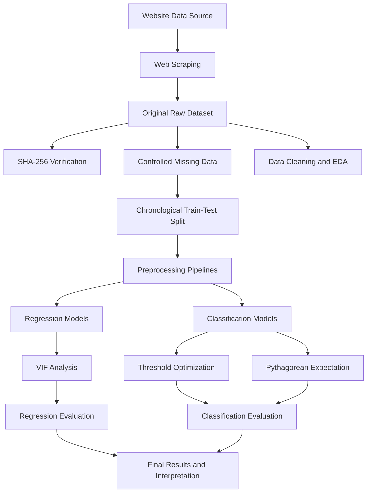

# Hockey Team Performance Analysis & Prediction


A Programming for AI semester project focused on analyzing historical hockey team performance using web scraping, data preprocessing, exploratory data analysis, regression, classification, and advanced machine learning techniques.

The project investigates the relationship between hockey team statistics and season performance by estimating the number of wins and classifying teams into winning and non-winning seasons.

---

## Table of Contents

- Project Overview
- Project Objectives
- Team Members and Contributions
- Dataset Description
- Repository Structure
- Project Workflow
- Web Scraping
- Data Preprocessing
- Exploratory Data Analysis
- Train-Test Split
- Regression
- Classification
- Advanced Techniques
- Model Evaluation and Results
- Installation and Setup
- Running the Project
- Reproducibility and Data Integrity
- Limitations
- Future Improvements
- Conclusion
- References

---

## 1. Project Overview

Hockey team performance depends on several factors, including goals scored, goals conceded, goal difference, and historical team statistics.

This project uses historical hockey team-season records collected from Scrape This Site to investigate these relationships through statistical analysis and machine learning.

Two supervised learning tasks are implemented:

### Task A — Regression

Predict the number of wins achieved by a hockey team during a season.

### Task B — Classification

Classify a hockey team's season as a winning or non-winning season based on its performance statistics.

A winning season is defined as:

- Win percentage greater than or equal to 0.500: Class 1
- Win percentage less than 0.500: Class 0

The project follows a complete machine learning workflow, starting with data collection and ending with model evaluation and interpretation.

---

## 2. Project Objectives

- Collect real-world hockey statistics through web scraping.
- Preserve the original scraped dataset.
- Introduce a controlled amount of missing data.
- Apply appropriate data cleaning and preprocessing techniques.
- Analyze numerical distributions and statistical relationships.
- Identify skewness and potential outliers.
- Encode categorical variables.
- Standardize numerical features.
- Prevent data leakage during model training.
- Implement and compare three regression models.
- Implement and compare three classification models.
- Apply two advanced machine learning techniques.
- Evaluate models using suitable performance metrics.
- Maintain reproducible results and data collection evidence.
- Maintain collaborative development history using Git and GitHub.

---

## 3. Team Members and Contributions

**Course:** Programming for AI

**Instructor:** Mahhek Tahir

**Team Size:** 2

| Team Member | Primary Responsibilities |
|---|---|
| Person A | Web Scraping, EDA, Regression, VIF Analysis |
| Person B | Missing Data Experiment, Preprocessing, Classification, Pythagorean Expectation |

**Team Roll Numbers:**

- 25L-0012
- 25L-2545

### Person A — Data Collection, EDA and Regression

- Website scraping using Requests and BeautifulSoup.
- Original dataset collection.
- Collection timestamps and SHA-256 fingerprint.
- Dataset inspection and cleaning.
- Exploratory data analysis.
- Distribution and outlier analysis.
- Regression preprocessing pipelines.
- Linear Regression.
- Decision Tree Regressor.
- Random Forest Regressor.
- Regression evaluation and interpretation.
- Multicollinearity analysis using VIF.

### Person B — Preprocessing and Classification

- Controlled missing-data experiment.
- Classification target generation.
- Missing-value analysis.
- Skewness and outlier analysis.
- Chronological dataset splitting.
- Median imputation.
- One-Hot Encoding.
- Standard Scaling.
- Classification preprocessing pipelines.
- Logistic Regression.
- Decision Tree Classifier.
- Random Forest Classifier.
- Confusion matrices and ROC curves.
- Classification threshold optimization.
- Pythagorean Expectation feature engineering.
- Final model comparison and interpretation.

---

## 4. Dataset Description

### Data Source

The dataset was collected from:

https://www.scrapethissite.com/pages/forms/

### Dataset Information

| Property | Value |
|---|---|
| Total records | 582 |
| Original columns | 10 |
| Working dataset columns | 11 |
| Historical period | 1990–2011 |
| Unique teams | 35 |
| Original missing values | 224 |
| Synthetic missing values | 58 |
| Duplicate records | 0 |
| Random seed | 12 |

Each row represents the performance statistics of a hockey team for a particular season.

### Dataset Attributes

| Column | Description |
|---|---|
| Team Name | Name of the hockey team |
| Year | Season year |
| Wins | Number of games won |
| Losses | Number of games lost |
| OT Losses | Number of overtime losses |
| Win % | Proportion of games won |
| GF | Goals For — goals scored |
| GA | Goals Against — goals conceded |
| +/- | Goal difference |
| collected_at | Data collection timestamp |
| Team_Status | Binary classification target |

The Team_Status column is generated during preprocessing and is not part of the original scraped dataset.

### Dataset Files

| File | Purpose |
|---|---|
| hockey_teams_raw.csv | Original unchanged scraped dataset |
| hockey_teams_missing.csv | Working dataset containing controlled missing values and Team_Status |
| hockey_teams_cleaned.csv | Cleaned version of the original dataset |

The original raw dataset is preserved throughout the project.

---

## 5. Repository Structure

```text
Hockey-Team-Performance-Analysis/
│
├── data/
│   ├── hockey_teams_raw.csv
│   ├── hockey_teams_missing.csv
│   └── hockey_teams_cleaned.csv
│
├── notebooks/
│   ├── project.ipynb
│   ├── EDA_org.ipynb
│   └── 03_classification.ipynb
│
├── src/
│   └── preprocessing.py
│
├── Problem statement/
│   ├── Hockey_Team_Performance_Project.pdf
│   └── Project_Instructions.pdf
│
├── .gitattributes
├── requirements.txt
├── Todo.png
└── README.md
```

### File Responsibilities

- **project.ipynb:** Website scraping, dataset collection and mandatory collection evidence.
- **EDA_org.ipynb:** Exploratory data analysis, data cleaning, regression models and VIF analysis.
- **03_classification.ipynb:** Classification preprocessing, model training, evaluation, threshold optimization and feature engineering.
- **preprocessing.py:** Reproducible generation of controlled missing values and classification labels.
- **requirements.txt:** Required Python environment dependencies.
- **.gitattributes:** Preserves the exact bytes of the original raw dataset by preventing Git line-ending conversion.

---

## 6. Project Workflow



---

## 7. Web Scraping

The original dataset was collected using Python web-scraping libraries.

### Libraries Used

- Requests
- BeautifulSoup
- Pandas
- Hashlib
- Datetime

### Collection Process

1. Establish an HTTP session.
2. Request the hockey statistics pages.
3. Extract HTML table rows using BeautifulSoup.
4. Extract individual hockey attributes.
5. Add a collection timestamp to each record.
6. Continue through the available pages.
7. Convert collected records into a Pandas DataFrame.
8. Save the original dataset as a CSV file.
9. Calculate the SHA-256 fingerprint.
10. Display the mandatory data collection log.

### Original Data Collection Log

| Property | Recorded Value |
|---|---|
| Collection start | 2026-11-15 13:05:49 |
| Collection end | 2026-11-15 13:06:18 |
| Total requests | 7 |
| Records collected | 582 |
| Raw dataset | hockey_teams_raw.csv |

### Original SHA-256 Fingerprint

```text
1985bac902d455f29c40365373b8b44342819075c646e950bfa9b72e7e10cf85
```

The original collection log is preserved in the scraping notebook.

---

## 8. Data Preprocessing

### 8.1 Controlled Missing-Data Experiment

A separate working copy of the original dataset was created.

Approximately 5% missing values were deliberately introduced into the GF and GA columns to simulate incomplete real-world data.

The missing positions were selected randomly without replacement using a fixed random seed.

```python
SEED = 12
```

| Feature | Synthetic Missing Values |
|---|---:|
| GF | 28 |
| GA | 30 |
| Total | 58 |

The selected columns contain 1,164 cells.

```text
Missing percentage = (58 / 1164) × 100
                   = 4.98%
```

Wins and Win % were protected from modification.

The original 224 missing OT Losses values were preserved in the working dataset.

### 8.2 Classification Target

The Team_Status target was generated from the original Win % column.

```python
df_missing["Team_Status"] = (
    df_missing["Win %"] >= 0.500
).astype(int)
```

| Class | Description |
|---|---|
| 0 | Non-winning season |
| 1 | Winning season |

### 8.3 Data Cleaning

The original dataset was cleaned separately by:

- Inspecting data types.
- Converting numerical attributes.
- Standardizing team-name formatting.
- Converting collection timestamps to datetime.
- Checking duplicate records.
- Handling historical missing OT Losses values.

Missing OT Losses values in the cleaned descriptive dataset were replaced with zero because this statistic was not separately recorded during the earlier historical seasons.

This is a historical data-handling convention, not a claim that overtime losses were measured as zero.

The cleaned dataset contains 582 records and 10 columns.

### 8.4 Missing-Value Imputation

Median imputation was applied to numerical model inputs using:

```python
SimpleImputer(strategy="median")
```

Median imputation was selected because it is less sensitive to extreme observations than mean imputation.

The imputer was fitted using training data only.

### 8.5 One-Hot Encoding

The Team Name feature was encoded using:

```python
OneHotEncoder(handle_unknown="ignore")
```

One-Hot Encoding avoids introducing artificial numerical rankings between hockey teams.

The encoder also handles categories that were not present during training.

### 8.6 Feature Scaling

Numerical model features were standardized using:

```python
StandardScaler()
```

Standardization subtracts the training mean and divides by the training standard deviation.

Scaling helps Logistic Regression optimization by placing numerical features on comparable scales.

Decision Tree and Random Forest models are generally less sensitive to scaling because they use feature-based splitting decisions.

### 8.7 Preprocessing Pipelines

Scikit-learn Pipeline and ColumnTransformer were used to combine preprocessing operations and machine learning models.

The numerical preprocessing pipeline consists of:

```text
Numerical Features
        ↓
Median Imputation
        ↓
Standard Scaling
```

The categorical pipeline consists of:

```text
Team Name
        ↓
One-Hot Encoding
```

The processed numerical and categorical features are combined before being passed to the model.

All preprocessing parameters are learned from training data rather than the final testing dataset.

---

## 9. Exploratory Data Analysis

Exploratory Data Analysis was performed to understand the characteristics of the dataset before model training.

### Analysis Performed

- Dataset shape inspection.
- Data type inspection.
- Summary statistics.
- Missing-value counts and percentages.
- Duplicate detection.
- Histograms.
- Boxplots.
- Skewness calculation.
- Outlier detection.
- Class distribution analysis.
- Numerical feature relationships.

### Classification Feature Skewness

| Feature | Skewness |
|---|---:|
| Year | -0.032 |
| GF | 0.257 |
| GA | 0.387 |
| +/- | -0.578 |

Year is approximately symmetric.

GF and GA show slight positive skewness, while goal difference shows moderate negative skewness.

No severe skewness requiring a major transformation was identified in these classification inputs.

### Outlier Detection

Potential outliers were identified using the Interquartile Range method.

```text
IQR = Q3 - Q1

Lower Bound = Q1 - 1.5 × IQR
Upper Bound = Q3 + 1.5 × IQR
```

Observations beyond these bounds were identified as potential outliers.

Unusual hockey statistics may represent genuine exceptional team performance rather than data collection errors. Therefore, valid extreme observations should not be removed automatically.

---

## 10. Train-Test Split

The dataset contains historical observations, so a chronological split was used instead of randomly mixing seasons.

| Dataset | Seasons | Records | Percentage |
|---|---|---:|---:|
| Training | 1990–2007 | 462 | 79.38% |
| Testing | 2008–2011 | 120 | 20.62% |
| Total | 1990–2011 | 582 | 100% |

The year 2008 was selected as the boundary closest to the required 80/20 split while preserving complete seasons.

### Classification Development and Validation

The training dataset was divided further for classification model development and threshold selection.

| Dataset | Records |
|---|---:|
| Development | 372 |
| Validation | 90 |
| Final testing | 120 |

The validation dataset was used for threshold optimization and evaluation of the additional Pythagorean Expectation feature.

The final testing dataset was reserved for final model evaluation.

### Data Leakage Prevention

The following variables were excluded from model inputs:

- Wins
- Win %
- Losses
- OT Losses
- collected_at
- Team_Status

Wins is used as the regression target.

Team_Status is used as the classification target.

Win %, Losses and OT Losses were excluded because they contain information closely related to the number of wins or the classification target.

The original input features are:

```python
features = [
    "Team Name",
    "Year",
    "GF",
    "GA",
    "+/-"
]
```

---

## 11. Task A — Regression

### Objective

Estimate the number of wins achieved by a hockey team using its season statistics.

### Target Variable

```python
y = df["Wins"]
```

### Models Implemented

#### Linear Regression

Models a linear relationship between the input features and the number of wins.

#### Decision Tree Regressor

Uses recursive feature-based decisions to estimate numerical outcomes.

#### Random Forest Regressor

Combines predictions from multiple decision trees to improve generalization and reduce dependence on a single tree.

### Evaluation Metrics

- MAE — Mean Absolute Error
- MSE — Mean Squared Error
- RMSE — Root Mean Squared Error
- R² — Coefficient of Determination

### Baseline Model

A baseline prediction was generated using the mean number of wins in the training dataset.

Baseline MAE: **7.090 wins**

The baseline provides a reference point for determining whether the machine learning models improve predictive performance.

---

## 12. Task B — Classification

### Objective

Classify hockey team seasons as winning or non-winning seasons.

### Target Variable

```python
y = df["Team_Status"]
```

### Models Implemented

#### Logistic Regression

Estimates the probability of a team belonging to the winning-season class.

#### Decision Tree Classifier

Classifies hockey teams using recursive feature-based decision rules.

#### Random Forest Classifier

Combines multiple decision trees to produce more robust classification predictions.

### Evaluation Metrics

- Accuracy
- Precision
- Recall
- F1-score
- Confusion Matrix
- ROC Curve
- ROC-AUC

### Threshold Optimization

The default probability threshold for binary classification is 0.50.

Different thresholds between 0.20 and 0.80 were evaluated using Logistic Regression validation probabilities.

The threshold of 0.20 produced the highest validation F1-score among the tested thresholds.

| Validation Metric | Threshold 0.50 | Threshold 0.20 |
|---|---:|---:|
| Accuracy | 0.6778 | 0.8333 |
| Precision | 1.0000 | 0.9762 |
| Recall | 0.4727 | 0.7455 |
| F1-score | 0.6420 | 0.8454 |

Lowering the threshold improved recall and F1-score while maintaining high validation precision.

The selected threshold was determined from validation data rather than the final test dataset.

---

## 13. Advanced Techniques

Two advanced techniques were selected based on the characteristics of the hockey dataset.

### Advanced Technique 1 — Variance Inflation Factor (VIF)

VIF was used to investigate multicollinearity among numerical regression features.

Goal difference is calculated as:

```text
Goal Difference = GF - GA
```

Therefore, GF, GA and goal difference are mathematically dependent.

VIF measures how strongly an input feature can be explained by the other input features.

```text
VIF = 1 / (1 - R²)
```

### Before-and-After VIF Comparison

| Feature | Before | After Removing +/- |
|---|---:|---:|
| Year | 1.105 | 1.105 |
| GF | Infinity | 1.282 |
| GA | Infinity | 1.274 |
| +/- | Infinity | Removed |

Removing goal difference resolved the perfect multicollinearity among the goal-related features.

### Linear Regression Comparison

| Metric | Before VIF | After VIF |
|---|---:|---:|
| MAE | 2.6342 | 3.0227 |
| RMSE | 3.3081 | 3.8221 |
| R² | 0.7636 | 0.6845 |

The reduced feature set improved the multicollinearity problem but produced lower predictive performance on the recorded test data.

This demonstrates the trade-off between feature redundancy, coefficient interpretability and predictive accuracy.

Because the working dataset contains missing GF and GA values, median imputation can also affect the original mathematical relationship between these features.

### Advanced Technique 2 — Pythagorean Expectation

Pythagorean Expectation is a domain-specific feature used to estimate a team's expected winning proportion from goals scored and goals conceded.

```text
PE = GF² / (GF² + GA²)
```

A higher Pythagorean Expectation indicates stronger scoring performance relative to goals conceded.

The feature was added using FunctionTransformer inside the numerical preprocessing pipeline.

```text
Median Imputation
        ↓
Pythagorean Expectation
        ↓
Standard Scaling
        ↓
Logistic Regression
```

Imputation is performed before calculating the new feature to handle missing GF and GA values.

### Before-and-After Feature Comparison

| Development Dataset | Features |
|---|---:|
| Original preprocessing | 38 |
| With Pythagorean Expectation | 39 |

### Validation Performance Comparison

Both models were compared using the same validation data and threshold of 0.20.

| Metric | Original | With Pythagorean |
|---|---:|---:|
| Accuracy | 0.8333 | 0.8333 |
| Precision | 0.9762 | 0.9762 |
| Recall | 0.7455 | 0.7455 |
| F1-score | 0.8454 | 0.8454 |
| ROC-AUC | 0.9371 | 0.9377 |

The additional feature produced a small improvement in ROC-AUC, although the threshold-based validation metrics remained unchanged.

This indicates a slight improvement in probability ranking rather than a substantial improvement in classification accuracy.

---

## 14. Model Evaluation and Results

### Final Regression Results

| Model | MAE | MSE | RMSE | R² |
|---|---:|---:|---:|---:|
| Linear Regression (VIF-reduced) | 3.023 | 14.609 | 3.822 | 0.6845 |
| Decision Tree | 3.042 | 14.392 | 3.794 | 0.6892 |
| Random Forest | **2.295** | **8.296** | **2.880** | **0.8208** |

### Best Regression Model: Random Forest

Random Forest achieved the lowest MAE, MSE and RMSE and the highest R² among the compared regression models.

Its MAE of 2.295 indicates an average absolute prediction error of approximately 2.3 wins.

The model explains approximately 82.08% of the observed variance in test-set wins relative to the R² reference.

It also substantially outperformed the baseline MAE of 7.090 wins.

### Final Classification Results

| Model | Accuracy | Precision | Recall | F1-score | ROC-AUC |
|---|---:|---:|---:|---:|---:|
| Logistic Regression | 0.7917 | 0.7253 | **1.0000** | 0.8408 | **0.9627** |
| Decision Tree | 0.8250 | 0.8082 | 0.8939 | 0.8489 | 0.8558 |
| Random Forest | **0.8500** | **0.9444** | 0.7727 | **0.8500** | 0.9517 |

### Best Classification Model: Random Forest

Random Forest achieved:

- Accuracy: 85.00%
- Precision: 94.44%
- Recall: 77.27%
- F1-score: 0.8500
- ROC-AUC: 0.9517

Random Forest produced the highest accuracy, precision and F1-score among the evaluated classifiers.

However, Logistic Regression achieved perfect recall and the highest ROC-AUC.

Therefore:

- Random Forest is preferable when overall accuracy and precision are important.
- Logistic Regression is preferable when identifying as many winning seasons as possible is important.
- Decision Tree provides a balance between precision and recall.

### Final Confusion Matrices

| Model | True Negative | False Positive | False Negative | True Positive |
|---|---:|---:|---:|---:|
| Logistic Regression | 29 | 25 | 0 | 66 |
| Decision Tree | 40 | 14 | 7 | 59 |
| Random Forest | 51 | 3 | 15 | 51 |

Random Forest produced the fewest false positive predictions.

Logistic Regression identified every actual winning season in the test dataset.

---

## 15. Technologies and Libraries

| Technology | Purpose |
|---|---|
| Python | Primary programming language |
| NumPy | Numerical computation |
| Pandas | Dataset manipulation |
| Requests | HTTP requests |
| BeautifulSoup | HTML parsing and web scraping |
| Matplotlib | Data visualization |
| Seaborn | Statistical visualization |
| Scikit-learn | Preprocessing, training and evaluation |
| Statsmodels | Variance Inflation Factor |
| Hashlib | SHA-256 fingerprint verification |
| Jupyter Notebook | Interactive development and documentation |
| VS Code | Development environment |
| Git | Version control |
| GitHub | Collaboration and repository management |

---

## 16. Installation and Setup

### Prerequisites

- Python
- Git
- VS Code or Jupyter Notebook
- Internet connection for dependency installation

### Clone the Repository

```bash
git clone https://github.com/Maazakhann/Hockey-Team-Performance-Analysis.git
```

### Navigate to the Project Directory

```bash
cd Hockey-Team-Performance-Analysis
```

### Create a Virtual Environment

```bash
python -m venv .venv
```

### Activate the Virtual Environment

Windows PowerShell:

```powershell
.\.venv\Scripts\Activate.ps1
```

Windows Command Prompt:

```cmd
.venv\Scripts\activate.bat
```

Linux or macOS:

```bash
source .venv/bin/activate
```

### Install Dependencies

```bash
python -m pip install -r requirements.txt
```

### Open in VS Code

```bash
code .
```

Select the Python interpreter associated with the project's virtual environment.

Open the notebooks using the Jupyter extension and select the corresponding Python kernel.

---

## 17. Running the Project

The repository already contains the original raw dataset, working dataset and cleaned dataset.

### Step 1 — Inspect Data Collection

Open:

```text
notebooks/project.ipynb
```

Review the saved collection output.

Do not rerun the scraping notebook when reproducing the submitted project, because a new collection may change timestamps and the original SHA-256 fingerprint.

### Step 2 — Generate Working Dataset (Optional)

The working dataset is already included.

To reproduce the controlled missing-data experiment, run the following command from the repository root:

```bash
python src/preprocessing.py
```

This generates:

```text
data/hockey_teams_missing.csv
```

The existing working dataset will be overwritten when this script is executed.

### Step 3 — Run Regression

Open:

```text
notebooks/EDA_org.ipynb
```

Select the correct Python kernel.

Restart the kernel and run all cells.

This notebook performs EDA, data cleaning, regression training, evaluation and VIF analysis.

It also generates the cleaned dataset.

### Step 4 — Run Classification

Open:

```text
notebooks/03_classification.ipynb
```

Restart the kernel and run all cells.

This notebook performs:

- Dataset verification.
- Data preprocessing.
- Chronological splitting.
- Model development.
- Classification evaluation.
- Threshold optimization.
- Pythagorean Expectation feature engineering.
- Final model comparison.

### Notebook Execution Order

```text
Original collection evidence
            ↓
preprocessing.py (optional)
            ↓
EDA_org.ipynb
            ↓
03_classification.ipynb
```

The modeling notebooks use relative paths to access the datasets in the data directory.

---

## 18. Reproducibility and Data Integrity

### Random Seed

The random seed was derived from the last four digits of the lowest team roll number.

```text
Lowest Roll Number: 25L-0012
Random Seed: 12
```

The seed is used for the controlled missing-data experiment and randomized model operations where applicable.

### SHA-256 Verification

The original raw CSV can be verified using Python:

```python
import hashlib

with open("data/hockey_teams_raw.csv", "rb") as f:
    fingerprint = hashlib.sha256(f.read()).hexdigest()

print(fingerprint)
```

Run the verification from the repository root.

Expected fingerprint:

```text
1985bac902d455f29c40365373b8b44342819075c646e950bfa9b72e7e10cf85
```

PowerShell verification:

```powershell
Get-FileHash data/hockey_teams_raw.csv -Algorithm SHA256
```

### Git Line-Ending Protection

The following rule is included in `.gitattributes`:

```text
data/hockey_teams_raw.csv -text
```

This prevents automatic Git line-ending conversion from modifying the original raw file.

The local file, committed file and remote repository file were verified against the original collection fingerprint during final integration.

### Mandatory Evidence

The project notebooks contain saved collection and training evidence, including:

- Team roll numbers.
- Original data source.
- Collection start and end timestamps.
- Number of requests.
- Total records.
- Original SHA-256 fingerprint.
- Model training timestamps.
- Random seed.
- Training and testing sizes.
- Final evaluation metrics.

---

## 19. Git and GitHub Collaboration

Git and GitHub were used to maintain a collaborative development history.

### Development Branches

| Branch | Purpose |
|---|---|
| main | Final integrated project |
| feature/a-extraction | Person A's extraction and regression development |
| feature/b-cleaning | Person B's preprocessing development |
| person-b-classification | Earlier classification integration |
| feature/b-classification | Person B's final classification development |

Both team members' development work was integrated into the main branch while preserving their commit histories.

The feature branches are retained as part of the development history.

### Repository

https://github.com/Maazakhann/Hockey-Team-Performance-Analysis

---

## 20. Project Limitations

- The dataset contains historical observations from 1990 to 2011.
- Modern hockey seasons are not represented.
- The dataset contains a limited number of team-season records.
- Historical changes in rules and season lengths may affect comparisons.
- Synthetic missing values may not represent all real-world missing-data patterns.
- Median imputation may reduce natural variation in some features.
- GF, GA and goal difference are mathematically related.
- Team names may change over time.
- Some models may be affected by class imbalance or differences between historical eras.
- Pythagorean Expectation produced only a small improvement in validation ROC-AUC.
- The classification definition is based on the assignment's Win % threshold and does not account for every possible definition of a successful season.
- Same-season statistics are generally available only during or after the season.

The project estimates performance using same-season statistics rather than providing a genuine pre-season forecast.

A true pre-season prediction model would require features collected before the target season begins.

---

## 21. Future Improvements

Potential extensions include:

- Collecting more recent hockey statistics.
- Introducing previous-season features.
- Building a genuine pre-season forecasting model.
- Applying chronological cross-validation.
- Performing additional hyperparameter optimization.
- Comparing median imputation with KNN or iterative imputation.
- Investigating missing-data patterns across historical eras.
- Applying permutation importance or SHAP for model interpretation.
- Developing additional domain-specific features.
- Exploring model calibration.
- Creating an interactive performance dashboard.
- Deploying models through a web-based prediction application.

These are potential future extensions and are not claimed as completed components of the current project.

---

## 22. Conclusion

This project demonstrates a complete data science and machine learning workflow using historical hockey team statistics.

The original data was collected through web scraping and preserved using SHA-256 fingerprint verification.

Controlled missing values were introduced into a separate working dataset, followed by exploratory data analysis, median imputation, categorical encoding, numerical scaling and chronological dataset splitting.

Three regression and three classification models were implemented and evaluated.

Random Forest achieved the strongest overall regression results, with an MAE of 2.295 wins and an R² of 0.8208.

Random Forest also achieved the highest classification accuracy of 85%, while Logistic Regression achieved the highest ROC-AUC of 0.9627 and perfect test-set recall.

The advanced techniques demonstrated the effects of multicollinearity and domain-specific feature engineering.

Overall, the project highlights the importance of reproducible data collection, appropriate preprocessing, data leakage prevention, model evaluation and careful interpretation of machine learning results.

---

## 23. References

1. Scrape This Site — Hockey Teams Dataset  
   https://www.scrapethissite.com/pages/forms/

2. Python Documentation  
   https://docs.python.org/3/

3. Pandas Documentation  
   https://pandas.pydata.org/docs/

4. NumPy Documentation  
   https://numpy.org/doc/

5. Scikit-learn Documentation  
   https://scikit-learn.org/stable/

6. Statsmodels Documentation  
   https://www.statsmodels.org/

7. Matplotlib Documentation  
   https://matplotlib.org/stable/

8. Seaborn Documentation  
   https://seaborn.pydata.org/

9. BeautifulSoup Documentation  
   https://www.crummy.com/software/BeautifulSoup/bs4/doc/

10. Programming for AI — Hockey Team Performance Analysis & Prediction Project Description.

11. Programming for AI — General Project Instructions.

---

**Developed as a semester project for the Programming for AI course.**
